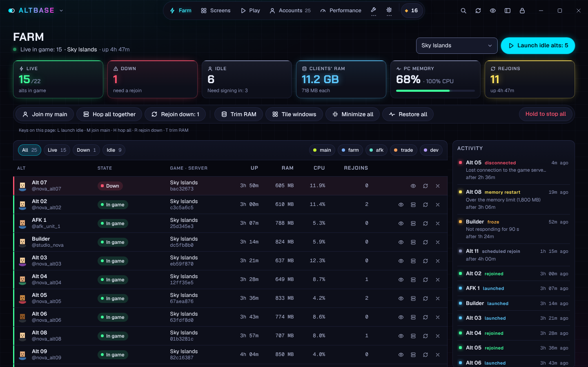

# Altbase

The Roblox alt farming command center for Windows.

 

Latest version · Windows 10 and 11 · free · <a href="../../releases">all releases</a>

Altbase runs your whole alt farm from one screen: every alt's state, server, uptime, RAM and CPU live,
one-click launches for every idle alt, auto-rejoin when Roblox kicks one, and the memory tricks that let
a normal PC hold far more clients. Everything stays on your PC: it talks to Roblox, and to Discord only if
you add your own webhook for alerts. No account and no telemetry; updates come straight from this GitHub repository.

## Features

- **Farm command center** — a live board of every alt (in game, joining, down, rejoining, idle) with
  its game, server, uptime, RAM, CPU and rejoins; a HUD of the whole farm; an activity feed of every
  launch, disconnect, freeze and rejoin. One click (or one key) to **launch every idle alt**, **send
  them all to your main's server**, **hop the whole farm to a fresh server together**, **rejoin
  everything that's down**, trim RAM, tile windows, or hold to stop it all.
- **Accounts** — add each account once through Roblox's own sign-in page. See presence, Robux,
  friends and sign-in health at a glance; group, alias and favourite them. Make them friends, join
  a Roblox group with several at once, and set display names and privacy in bulk.
- **Launch anything** — paste a game link, private server, share link, place ID or `@username` and
  send one account or a whole group in, even into the same server.
- **Many clients at once** — multi-instance, window layouts, live previews on Home, auto-rejoin,
  scheduled rejoin every few hours, crash restart and anti-AFK.
- **Servers** — browse a game's public and private servers by players or ping (fewest players first
  for a quiet one) and send any accounts into the one you pick.
- **Performance** — presets from "Max alts" to Roblox defaults: FPS caps, lowest graphics, tiny or
  hidden windows, CPU limits for background clients, memory trimming and memory restarts.
- **System memory** — a RAMMap-style view of what your PC's memory holds (in use, modified,
  standby, free), a one-click trim of every Roblox client, and RAMMap's Empty commands (standby
  list, modified list, working sets) behind a single administrator prompt.
- **Encrypted vault** — cookies encrypted with Windows DPAPI, or with a master password
  (Argon2id + AES-256-GCM) with auto-lock, a recovery code and throttled unlock attempts.
- **Built for unattended farming** — start with Windows, play a favourite by itself when Altbase
  opens, hop a client to another server, a launch guard (most clients at once, memory to keep
  free) and an automatic trim when the PC's memory fills up.
- **Fast to drive** — a Home dashboard, named tabs, and a command palette (Ctrl+K) that finds any
  page, account, favourite, action or setting.
- **Accessibility** — text size up to 150%, a higher-contrast palette, an easier-to-read font,
  thicker focus rings, reduced or no motion, and full keyboard use.
- **Streamer mode** — one switch hides usernames, user IDs, job IDs and cookies.
- **Neon dark interface**, in 18 languages, with an optional spoken greeting at start.

## Install

1. **[Download Altbase-Setup.exe](https://github.com/SaisOnYou/altbase/releases/latest/download/Altbase-Setup.exe)**. It's always the newest version.
2. Run it. Windows shows a blue "Windows protected your PC" box because the installer isn't
   code-signed: click **More info → Run anyway**. It installs just for you, no admin rights needed.
3. Altbase opens. Add your accounts under **Accounts → Add account**.

Needs Windows 10 (1809 or later) or Windows 11, with the WebView2 runtime (Windows 11 has it; the
installer offers it if it's missing).

After that, **Altbase updates itself**: it checks this repository's releases every hour and, while no
Roblox client is running, installs the new version and restarts, keeping your accounts and settings.
Every update's installer must carry this project's signature, or it isn't run. You can turn this off
in **Settings → About**.

To build it yourself, see [BUILD.md](BUILD.md).

## Safety

Altbase never patches, injects into or reads the memory of the Roblox client. Multi-instance works by
holding Roblox's single-instance lock before a client starts; anti-AFK sends an ordinary key press.
Running several accounts and anti-AFK may still go against a game's own rules: use them at your own
risk. Never share your cookies or an exported cookie file: anyone who has one *is* that account.

## Credits

Made by **sais7777** and **ceficat**. Built with [Claude](https://claude.ai).

## License

MIT. See [LICENSE](LICENSE).
